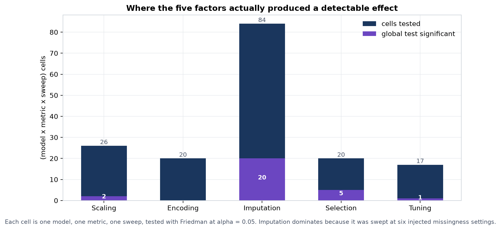
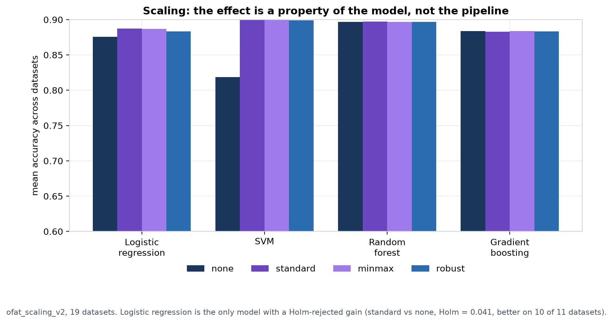
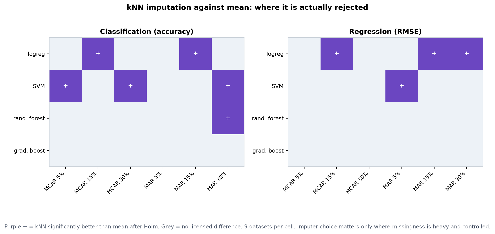
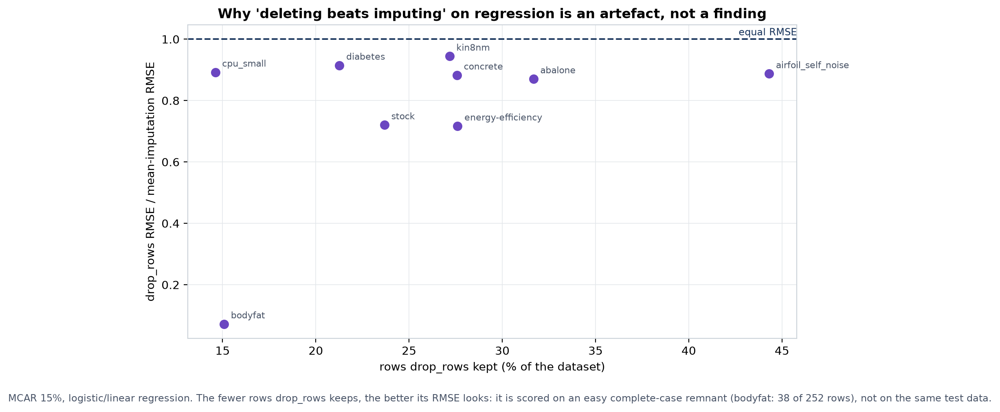
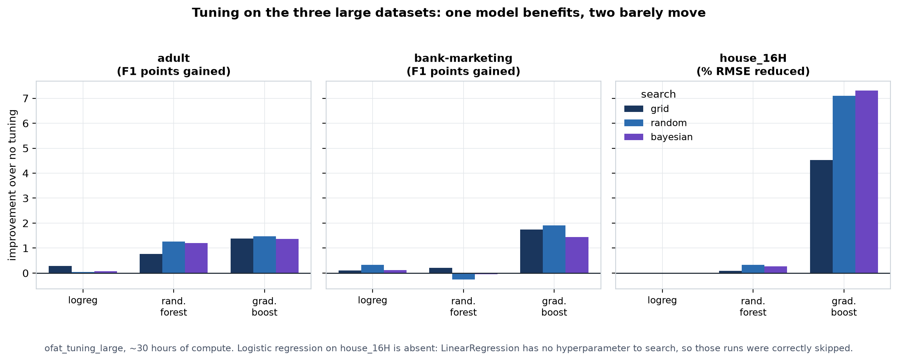
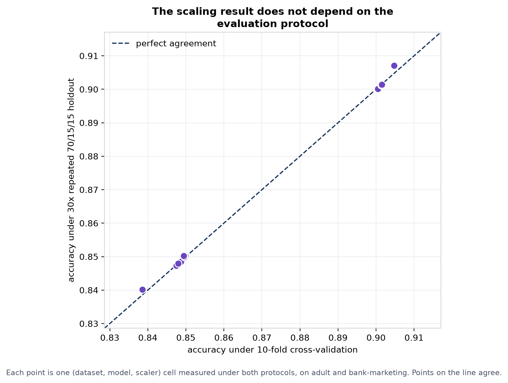

# Pipeline Lab: what 4,377 runs say about preprocessing choices

**Programme report, 2026-10-16.** Colile Sibanda, ITRI671 Honours, NWU.

This report covers the whole Pipeline Lab programme: the five-component
OFAT study (encoding, imputation, scaling, selection, tuning), the
injected-missingness arm, the large-dataset arm, and the repeated-holdout
secondary protocol. Every number is recomputed from `outputs/lab.db`
with the engine's own `compare_levels` (Friedman, then baseline-referenced
Wilcoxon, then Holm), not quoted from the process log. Figures are in
`docs/figures/`.

---

## 1. Scope

| | |
|---|---|
| Runs recorded | **4,377** (4,105 succeeded, 236 skipped, 36 failed) |
| Sweeps | 23 configs |
| Datasets | 25 |
| Models | logistic regression, SVM, random forest, gradient boosting |
| Protocols | stratified 10-fold CV; 30x repeated 70/15/15 holdout (secondary) |
| Total compute | **81.4 wall hours**, 71.0 CPU hours |
| Statistical cells tested | 167 (model x metric x sweep) |
| Cells with a significant global test | 28 |
| **Rejected contrasts after Holm** | **25** |

Every failed run has a recorded cause and a fix (sections 4j, 4s of the
process log); none is unexplained.

---

## 2. The headline: most preprocessing choices do not matter, and the
## ones that do are model-specific

**Figure 1.** Of 167 tested cells, 28 cleared the global test. The
distribution is not even across factors, and the shape of that unevenness
is the main result of the programme.

| Factor | Cells tested | Significant | Rejected contrasts |
|---|---|---|---|
| Scaling | 26 | 2 | **1** |
| Encoding | 20 | 0 | **0** |
| Imputation | 84 | 20 | **21** |
| Selection | 20 | 5 | **0** |
| Tuning | 17 | 1 | **1** |

Three readings follow, and the third is the one that matters most.

1. **Encoding produced nothing at all.** Twenty cells, no detectable
   global difference anywhere, across 19 datasets and two large
   categorical ones. One-hot, ordinal and target encoding are
   interchangeable *on average* at the level this design can resolve.
2. **Imputation dominates the significant results**, but only because it
   was swept at six controlled missingness settings. That is a design
   artefact of where effort went, not evidence that imputation is
   intrinsically the most important factor.
3. **Selection has five significant global tests and zero surviving
   contrasts.** That combination is not a null. It is a power ceiling,
   and section 6 explains why it was mathematically impossible for those
   five to reject.

---

## 3. Scaling: a property of the model, not of the pipeline

**Figure 2.** Mean accuracy by model and scaler, 19 datasets.

The whole scaling effect lives in two of the four models:

- **Logistic regression** is the only model with a Holm-rejected gain:
  standard scaling versus none, Holm = 0.0410, better on **10 of 11**
  datasets. This is one of only two non-imputation rejections in the
  programme.
- **SVM** shows the largest raw movement anywhere in the study, but on
  the large datasets where n is too small to test: on adult, macro-F1
  rises from 0.579 unscaled to 0.787 standardised (**+20.8 points**); on
  bank-marketing, 0.477 to 0.708 (**+23.1 points**). Reported as a direct
  reading, not a tested finding (n = 2).
- **Random forest and gradient boosting are flat.** Across every scaling
  sweep, tree ensembles move by fractions of a point. This is the
  expected theoretical result and the data agrees with it.

### The house_16H mechanism, verified

The sharpest single mechanism in the programme. On house_16H, scaling
improves LinearRegression RMSE by 7.7%, which looked like a contradiction
because least squares is scale-invariant in exact arithmetic. The cause
was traced directly:

| check | result |
|---|---|
| feature standard deviations | one near 66,000; other fifteen below 0.34 |
| condition number, raw | 1.4e7 |
| rank sklearn reports, raw | **9 of 16** |
| rank sklearn reports, scaled | 16 of 16 |
| raw at default `tol=1e-6` | RMSE 49,412.8 |
| raw at `tol=1e-9` | rank 16, RMSE **45,539.1** |
| scaled | RMSE **45,539.1** |

sklearn's least-squares solver discards singular values below
`tol x largest`. With one feature on a scale 200,000 times the others,
seven of sixteen directions fall under the cutoff and are silently
dropped. **The estimator is scale-invariant; the unscaled model simply
was not the full model.** The practical lesson is sharper than "scaling
helps linear models": on data with one dominant-scale feature, not
scaling can silently remove features from a linear model without any
error or warning.

---

## 4. Imputation: the answer depends entirely on which question is asked

This arm produced 21 of the programme's 25 rejections, and it is also
where the most careful reading is required, because the same data gives
opposite answers to two different questions.

### 4.1 "Which imputer is best?" — answered against `mean`

**Figure 3.** kNN against mean imputation across rate and mechanism.

- **kNN beats mean** in 9 cells, concentrated at 15% and 30% missingness
  under both MCAR and MAR, typically better on 7 or 8 of 9 datasets.
- **Median is significantly *worse* than mean for regression**, rejected
  in 5 of 6 sweeps and worse on **all 9 datasets** in three of them. This
  is the most directionally consistent single result in the programme.
- **Gradient boosting is indifferent to the imputer** in all six sweeps,
  on both task types.

Against B2's prior finding (kNN best at 5% and 15% under both mechanisms,
gone by 30%): the lab **agrees at 15%** under both mechanisms, **does not
reproduce the 5% result** (kNN leads on 7 of 9 but is not rejected), and
**finds a kNN advantage at 30% MAR that B2 did not**. Partial agreement
from a different dataset and model set, and it should be described that
way.

### 4.2 "Should I impute at all?" — answered against `drop_rows`

Read against the Chapter 1 baseline instead, the same sweeps give 36
rejections. On **classification** these say imputing beats deleting
(gradient boosting, 5% MCAR: all three imputers rejected, better on 7-8
of 8). On **regression** they appear to say the opposite: `drop_rows`
beats every imputer, on 0 or 1 of 9 datasets.

**That regression result is an artefact and must not be reported as a
finding.**

**Figure 4.** Why. `drop_rows` is not scored on the same data as the
imputers. On bodyfat at 15% MCAR it keeps **38 of 252 rows** and posts
RMSE 0.21 against mean imputation's 2.90 — a 14x "advantage" earned by
discarding 85% of the data and scoring on an easy complete-case remnant.
Every point in the figure sits below the parity line, and the fewer rows
kept, the better `drop_rows` looks. The process log flagged this in prose
(section 4k); quantifying it across the arm shows it is systematic.

**Reported position: the `drop_rows` comparison is a comparison of two
workflows, not a like-for-like comparison of test sets, and the
regression direction is driven by sample attrition rather than by
imputation quality.**

### 4.3 The natural-missingness null, correctly qualified

Read against `mean` on the uninjected sweep, nothing is significant
anywhere — every p above 0.09, several above 0.6. The reason is not that
imputer choice does not matter:

**15 of the 19 datasets have 0.00% missing values.** The imputers have
nothing to act on and are necessarily identical there. Only colic (20.1%)
has a rate comparable to the injected sweeps.

This null **cannot distinguish "imputer choice does not matter" from
"imputer choice was never tested"**, and the report states the second.

---

## 5. Tuning: 67% of the compute, one result

**Figure 5.** Improvement over no tuning on the three large datasets.
*Note: the house_16H panel is in % RMSE reduced while the other two are
in F1 points, so bar heights are not comparable across panels.*

Tuning consumed **54.4 of the programme's 81.4 wall hours (67%)** across
`ofat_tuning_v2`, `v3` and `ofat_tuning_large`, and produced exactly
**one** rejected contrast in the entire programme: grid search on the SVM
regressor, Holm = 0.0469, better on 7 of 7 datasets.

On the large datasets, read directly (n too small to test):

- **Gradient boosting is the one model tuning reliably moves**: +1.4 to
  +1.9 F1 points on adult and bank-marketing, 4.5-7.3% RMSE reduction on
  house_16H, consistent across all three search strategies.
- Random forest moves slightly; logistic regression barely at all.
- **Grid, random and Bayesian search are indistinguishable from each
  other** on every model and dataset.

### The correction that mattered

`ofat_tuning_v2` reported Bayesian search beating no tuning for the SVM
(p = 0.0145). It did not survive. Every grid held 4-6 candidates while
random search drew 10, so **random search exhausted the grid and became
grid search on all 56 model-dataset pairs**, and Bayesian drew from the
same handful of points. Given real continuous search spaces in `v3`, the
same contrast reads p = 0.2330 and the gain reverses on two datasets.

Had v2 been reported as final, the thesis would have claimed Bayesian
tuning helps the SVM. **It was measuring how well Bayesian search
rediscovers a small fixed grid, not how well it tunes a model.**

---

## 6. The most important methodological finding: a power ceiling that
## made five results impossible to detect

Selection produced five significant global tests — one at p = 0.0009 —
and **not one surviving pairwise contrast**. That is not a null result.
It is arithmetic.

The Wilcoxon signed-rank test on n paired datasets has a smallest
attainable two-sided p of `2 / 2^n`. Holm then multiplies the smallest of
k comparisons by k:

| datasets (n) | levels compared (k) | smallest attainable Holm p | can anything reject at 0.05? |
|---|---|---|---|
| 7 | 3 | 0.0469 | yes, barely |
| **7** | **4** | **0.0625** | **no — impossible** |
| 9 | 4 | 0.0156 | yes |
| 11 | 4 | 0.0039 | yes |

**At n = 7 regression datasets with 4 selection levels, no result can be
rejected, however large the true effect.** The three selection regression
cells at n = 7 (Friedman p = 0.0009, 0.0010, 0.0021 — among the strongest
global signals in the programme) were structurally undetectable before
any data was collected.

This is why the three regression datasets were added mid-programme,
taking regression from 4 to 7 datasets, and it is why a fourth would have
been needed for the selection arm specifically. **Design power must be
checked against the discreteness floor of the chosen test, not against
alpha alone** — a 6-dataset design clears alpha = 0.05 but fails the
alpha/3 Holm bar, which is the trap that made an earlier power warning in
this project wrong.

---

## 7. The results are not an artefact of the evaluation protocol

**Figure 6.** 16 (dataset, model, scaler) cells measured under both
10-fold CV and 30x repeated 70/15/15 holdout. Points lie on the parity
line.

The methodology rejected a single train/test split; repeated holdout
answers that objection. On the four largest datasets it reproduces the
k-fold record in direction and magnitude, including the house_16H
signature where minmax, standard and robust give byte-identical RMSE
(45,829.3) against raw 49,445.8 — the exact fingerprint of the solver
rank cutoff from section 3, appearing under a completely different split
structure. **The mechanism is a property of the data and the solver, not
of the evaluation protocol.**

---

## 8. What the programme actually supports

Stated at the confidence the evidence carries:

**Tested and rejected (Holm-corrected):**
1. Standard scaling beats no scaling for logistic regression (10 of 11 datasets).
2. Grid search beats no tuning for the SVM regressor (7 of 7 datasets).
3. kNN beats mean imputation at 15-30% injected missingness, model-dependent (9 contrasts).
4. Median is worse than mean for linear regression under injected missingness (5 of 6 sweeps).
5. Imputing beats deleting rows for gradient boosting on classification.

**Strong direct readings, not formally testable (n = 1-2 datasets):**
6. SVM gains 20+ F1 points from standard scaling on large datasets.
7. Gradient boosting is the only model large-dataset tuning reliably helps.
8. Ordinal encoding costs logistic regression 7-8 F1 points on both large categorical datasets.
9. L1 selection prunes 104 features to 5 on adult but 51 to 49 on bank-marketing — the same technique, at the same setting, behaving completely differently by dataset.

**Honest nulls:**
10. Encoding shows no detectable effect anywhere (20 cells).
11. Tree ensembles are indifferent to scaling, and gradient boosting to the imputer.
12. No search strategy beats any other.

**Not supported, and explicitly withdrawn:**
13. Bayesian tuning helping the SVM (v2 artefact, corrected in v3).
14. Deleting rows beating imputation on regression (sample-attrition artefact).
15. Any claim about imputer choice under *natural* missingness in this registry.

---

## 9. What was learnt about doing this kind of study

The methodological lessons are at least as valuable as the empirical ones,
and several were learnt the hard way.

**Check the power floor before collecting data, not after.** Five
significant global tests produced zero contrasts because n = 7 with k = 4
makes rejection arithmetically impossible. No amount of compute fixes a
design that cannot reject.

**A baseline choice is a research question, not a formatting detail.**
The same imputation data says "impute" or "delete" depending on whether
the reference is `drop_rows` or `mean`. Both readings are in this report
because neither alone is honest.

**Verify a mechanism before naming it.** The house_16H effect was first
attributed to vague "numerical conditioning". The real cause — a solver
rank cutoff silently discarding seven of sixteen feature directions — is
both more specific and more useful, and was only found by checking
instead of assuming.

**Baselines must be scored on the same data.** `drop_rows` looked
excellent on regression purely because it was evaluated on 15% of the
rows. Any comparison where the baseline changes the test set needs that
stated at the point of the claim.

**A search budget larger than the search space is not a search.** Random
and Bayesian tuning silently degenerated into grid search on all 56
pairs. The bug produced plausible numbers and a publishable-looking
result; only an explicit check for identical scores exposed it.

**Latent bugs surface at scale, not in tests.** The chi2 sparse-matrix
crash and the rank-deficiency effect both needed a dataset wide enough to
trigger them. 342 passing unit tests did not catch either.

**Do not infer a stall from a CPU reading.** Three times a long run was
judged hung on near-zero CPU and a parked thread; each time direct
isolated measurement showed it was genuinely computing (rfe+svm: 533s per
fit; random+random_forest: 1,259s; random+gradient_boosting: 1,071s). One
of those misjudgements cost 13 valid rows and a restart. The reliable
check is measuring the same combination in isolation, not reading the
process table.

**Append-only is a discipline, not a database setting.** Two sweeps were
restarted after bugs. Because `lab.db` had not been committed, the bad
rows could be discarded cleanly rather than living in the record forever.
Commit boundaries are what make a record correctable.

---

## 10. Honest limitations

- **n is 1-2 datasets on every large-dataset arm**, so sections 3 (SVM),
  5 (tuning) and the encoding and selection large-dataset results are
  direct readings with no significance test behind them.
- **Natural missingness was effectively absent** (15 of 19 datasets at
  0.00%), so the uninjected imputation arm tests almost nothing.
- **SVM tuning on large datasets was never run.** Its cost was never
  measured and it is the one remaining gap in the five-factor design.
- **Effect sizes across datasets with different target scales** (RMSE in
  particular) are not commensurable; sign and win-count are the reliable
  parts, not the magnitude of the median difference.
- **OFAT cannot see interactions.** Every result here holds one factor at
  its baseline while varying another; Part 2 of the programme is where
  interaction effects belong.

---

*Generated from `outputs/lab.db` at 4,377 runs. Analysis scripts and the
figure generator produce every number and plot in this report from the
database directly.*
