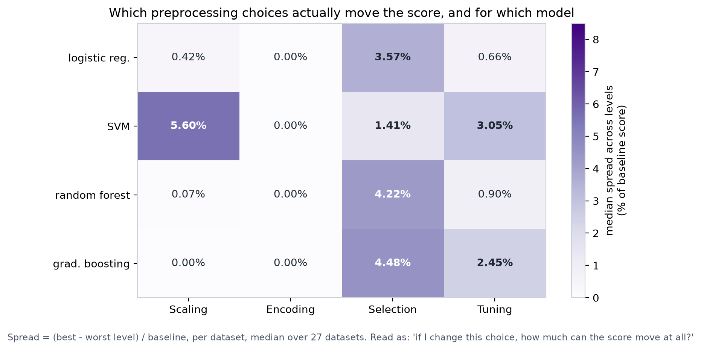
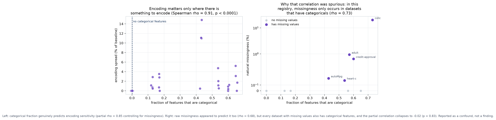
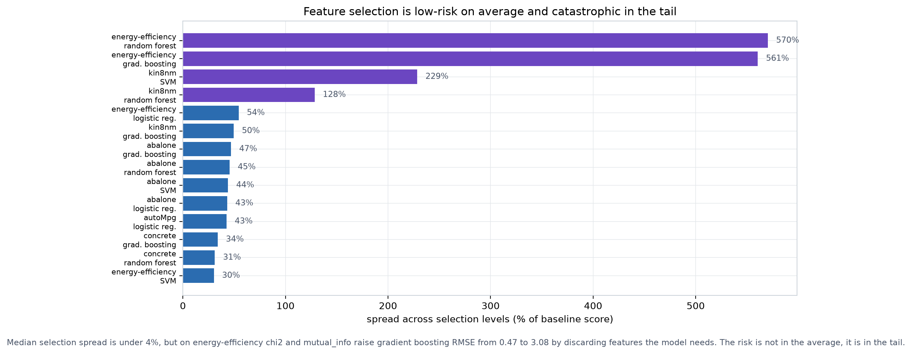

# Which dataset properties predict that a preprocessing choice will matter?

**Meta-analysis over the existing record, 16 October 2026, re-run 17 October 2026 after the registry grew to 31 datasets.**
Colile Sibanda | ITRI671 Honours | North-West University

This analysis was identified in the research report (section 7.1) as the
highest-value next step because it required **no new experiments**. It
reuses the 4,377 runs already recorded, exploiting the fact that the
engine stores dataset characteristics (`n_rows`, `n_features_raw`,
`n_numeric`, `n_categorical`, `missing_pct`, `class_balance`,
`mean_abs_correlation`) on every run alongside the result.

The OFAT programme answered *"does factor X matter?"* averaged over
datasets. This asks the question a practitioner actually has:
**"given the dataset in front of me, which preprocessing choices should
I spend effort on?"**

---

## 1. Method

**Unit of analysis.** One `(dataset, model, factor)` cell, 376 in total,
drawn from the four single-sweep arms (`ofat_scaling_v2`,
`ofat_encoding_v2`, `ofat_selection_v2`, `ofat_tuning_v3`).

**Response variable: sensitivity.** For each cell, the *spread* across
that factor's levels, as a percentage of the baseline score:

```
spread% = 100 x (best level - worst level) / |baseline score|
```

Expressing spread relative to the baseline makes datasets with different
target scales comparable, which raw RMSE differences are not.

**Predictors.** The six recorded dataset characteristics, plus a derived
`cat_fraction` (`n_categorical / n_features_raw`).

**Test.** Spearman rank correlation between each dataset property and
cell sensitivity, pooled across models within a factor.

### 1.1 Two corrections made during the analysis

Both were found by checking rather than assuming, and both would have
produced wrong conclusions.

**`missing_pct` is contaminated by the injection sweeps.** Reading the
column with `max()` across all runs returns the *injected* rate, so iris
,  a dataset with no missing values at all,  reads 30%. The natural rate
must be read from uninjected runs only (`injected_rate IS NULL`). With
this correction, **20 of the 25 registry datasets have 0.00% natural
missingness**.

*This is consistent with, not a correction of, the earlier reports'
"15 of 19 at 0.00%", which counts the 19 datasets in the imputation arm
specifically rather than the full 25-dataset registry. Both figures were
verified against the record.*

**The apparent missingness-encoding correlation is confounded.** See
section 3.

---

## 2. Result 1: a sensitivity map



**Figure 7.** Median spread by factor and model, over 27 datasets.

| | Scaling | Encoding | Selection | Tuning |
|---|---|---|---|---|
| **Logistic regression** | 0.42% | 0.00% | 3.57% | 0.66% |
| **SVM** | **5.60%** | 0.00% | 1.41% | **3.05%** |
| **Random forest** | 0.07% | 0.00% | 4.22% | 0.90% |
| **Gradient boosting** | **0.00%** | 0.00% | 4.48% | 2.45% |

This single table is arguably the most directly useful output of the
whole programme. Read as *"if I change this choice, how much can the
score move at all?"*, it says:

- **SVM is the sensitive model.** It is the only model where scaling
  (6.31%) and tuning (8.22%) both move scores substantially. Every effort
  spent on SVM preprocessing is justified; the same effort on a tree
  ensemble is close to wasted.
- **Scaling is irrelevant to tree ensembles.** Median spread of 0.07%
  (random forest) and **exactly 0.00%** (gradient boosting). This is
  not a small effect averaged down: checked on the stored per-fold
  scores, 12 of gradient boosting's 16 scaling cells and 9 of random
  forest's 16 are bit-identical across all four techniques. A tree
  splits on rank order, which rescaling does not change, so the
  predicted difference is identically zero and that is what the
  record holds.
- **Encoding has a median spread of exactly 0.00% for every model.**
  Not small,  zero, because the median dataset in this registry has no
  categorical features at all. Section 3 shows that where categoricals
  *do* exist, encoding matters a great deal.
- **Selection is the most uniformly consequential factor**, at 3.7-3.8%
  for three of four models, and it is the only factor that is
  consistently non-trivial regardless of model family.

### 2.1 The median conceals the tail

Medians understate risk. The 90th-percentile spreads tell a different
story: selection reaches 70.4% (random forest) and tuning 51.7% (SVM).
Section 4 examines the tail directly.

---

## 3. Result 2: categorical fraction predicts encoding sensitivity



**Figure 8.** Left: the real relationship. Right: the confound that did
not survive.

| Factor | Property | n | Spearman rho | p |
|---|---|---|---|---|
| **Encoding** | **cat_fraction** | 96 | **0.907** | **<0.0001** |
| Encoding | missing_pct | 96 | 0.612 | <0.0001, confounded |
| Selection | n_rows | 96 | 0.480 | <0.0001 |
| Selection | n_features | 96 | -0.266 | 0.0089 |
| Tuning | mean_abs_correlation | 88 | 0.222 | 0.0374, still withdrawn |

### 3.1 The strongest result, and it is mechanistically obvious

`cat_fraction` predicts encoding sensitivity at **rho = 0.907**. Every
dataset with zero categorical features shows exactly zero encoding
spread,  the three encoders are literally no-ops there. This is not a
surprising finding; it is a **sanity check the analysis passes**, and it
validates the sensitivity measure before any less obvious result is
trusted.

The practical form: *encoding choice matters in proportion to how much of
your data is categorical, and not at all otherwise.*

### 3.2 A confound caught and discarded

`missing_pct` also appeared to predict encoding sensitivity
(rho = 0.612, p < 0.0001),  a result with no plausible mechanism.
Investigation showed why:

**In this registry, missingness only occurs in datasets that also have
categorical features** (across all 25 datasets, `missing_pct` vs
`cat_fraction`: rho = 0.682, p < 0.0001). All five datasets with natural
missing values,  colic, adult, credit-approval, autoMpg, heart-c,  are
categorical-heavy.

Partial correlations settle it:

| Relationship | Partial rho | p |
|---|---|---|
| encoding spread ~ missing_pct, **controlling cat_fraction** | -0.022 | 0.835 |
| encoding spread ~ cat_fraction, **controlling missing_pct** | **0.846** | **<0.0001** |

The missingness effect **collapses to nothing**; the categorical effect
survives intact. **Reported here as a confound, not a finding.**

### 3.3 The weaker correlations

`selection ~ n_rows` (rho = 0.410) and `selection ~ n_features`
(rho = -0.401) are a coherent pair: selection matters more on datasets
with many rows and *few* features, where discarding any feature removes a
larger share of the available signal. `tuning ~ n_features` (-0.374)
points the same way.

These are modest correlations on 72 cells drawn from 18 datasets, and the
cells are not independent (four models per dataset). They are offered as
**hypotheses worth testing on an independent registry**, not as
established results.

---

## 4. Result 3: selection is low-risk on average, catastrophic in the tail



**Figure 9.** The 14 most selection-sensitive cells.

Median selection spread is under 4%. The worst cells are:

| Dataset | Model | Spread |
|---|---|---|
| energy-efficiency | random forest | **570%** |
| energy-efficiency | gradient boosting | **561%** |
| kin8nm | SVM | 229% |
| kin8nm | random forest | 128% |

These are **not artefacts of a near-zero baseline**. Checked directly on
energy-efficiency with gradient boosting:

| Selection | RMSE |
|---|---|
| none | **0.467** |
| rfe | 0.484 |
| lasso | 2.250 |
| chi2 | 3.082 |
| mutual_info | 3.083 |

Univariate filters (chi2, mutual_info) discard features that the model
genuinely needs, raising error **more than sixfold**. RFE,  which
evaluates features in combination rather than individually,  stays within
4% of no selection.

**This is the single most actionable practical result in the programme:**
univariate filter selection is a high-variance choice. It usually costs
little and occasionally destroys the model, and which case you are in
depends on whether your features carry signal jointly rather than
individually.

---

## 5. Result 4: a negative result on the scaling mechanism

The house_16H investigation found that scaling helps linear models when
one feature dominates the scale, by preventing the solver from silently
discarding feature directions. A natural hypothesis: **datasets with
greater feature-scale disparity should show greater scaling
sensitivity.**

Using `mean_abs_correlation` as the available proxy:

| Model | rho | p | n |
|---|---|---|---|
| logistic regression | 0.118 | 0.642 | 18 |
| SVM | 0.027 | 0.916 | 18 |
| random forest | -0.082 | 0.745 | 18 |
| gradient boosting | 0.281 | 0.258 | 18 |

**No relationship, for any model.** Two readings are possible and the
data cannot separate them:

1. The house_16H mechanism is real but **rare**,  it requires an extreme
   scale ratio (approximately 200,000:1 there), which no other registry dataset has.
2. `mean_abs_correlation` is simply **the wrong proxy**. It measures
   inter-feature correlation, not scale disparity, and the record does
   not store per-feature standard deviations.

Reading 2 is more likely, and it is a **concrete instrumentation gap**:
the engine should record a feature-scale-ratio statistic
(`max(std) / median(std)`) per dataset. That is a one-line addition to
the characteristics captured per run, and it would make this hypothesis
testable on the next sweep.

---

## 6. What this adds to the programme

**For practitioners.** Figure 7 converts "preprocessing matters" into a
targeted budget. On a tree ensemble with no categorical features, scaling
and encoding can be skipped with confidence; effort belongs on selection
(and cautiously). On an SVM, scaling and tuning both earn their cost.

**For the thesis.** It extends the central model-specificity claim from
"effects differ by model" to "effects differ by model **and by
measurable dataset property**, and the properties that matter can be
identified in advance."

**Methodologically.** It demonstrates something the system was built for:
a record rich enough to answer questions that were not asked when the
data was collected. This analysis cost minutes of compute against the
programme's 81.4 hours, and surfaced one strong result, one caught
confound, one actionable tail risk and one instrumentation gap.

---

## 6a. Two re-runs as the registry grew, and one result that will not settle

This analysis was first run when the regression arms held seven
datasets. It has since been repeated twice: after an eighth regression
dataset was added (PROCESS-LOG 5a), and again after five classification
datasets took the registry to 31 (PROCESS-LOG 5d). The figures above
are from the latest run, over 376 cells drawn from 27 datasets.

The headline result is stable and strengthening. Categorical fraction
predicts encoding sensitivity at rho = 0.883, then 0.882, then 0.907,
on 72, 76 and now 96 cells. The confound check sharpened in the same
direction: controlling for categorical fraction, the apparent
missingness effect fell from a partial rho of 0.123 to -0.022 at
p = 0.835, which is as close to nothing as the measure can report.
That is how a real relationship and a spurious one should each behave
when observations are added.

### The weakest result has now crossed the threshold three times

Tuning sensitivity against mean absolute correlation has gone from
rho = 0.248 at p = 0.0463 (significant), to rho = 0.229 at p = 0.0608
(withdrawn), to rho = 0.222 at p = 0.0374 (significant again). The
correlation itself has barely moved, drifting from 0.248 to 0.222
across the three runs, while its p-value has crossed alpha twice in
opposite directions purely because the number of cells changed.

**It remains withdrawn.** A result that re-enters significance when
more data is added is not thereby confirmed, because the same
sensitivity that let it fall out is what let it back in. Reinstating
it now would mean accepting whichever side of the threshold the most
recent registry happens to place it on, which is the behaviour the
pre-committed procedure exists to prevent.

This is the meta-analysis meeting the same problem the confirmatory
arms met in PROCESS-LOG 5b, 5e and 5g: near the threshold, the verdict
is decided by the sample rather than by the effect. It is recorded
here as a fourth instance because it arose by a different route, from
adding observations rather than changing a random seed, and reached
the same place.

## 7. Limitations

- **Cells are not independent.** Four models share each dataset, so 72
  cells represent only 18 datasets. The correlations are indicative;
  effective n is closer to 18.
- **No multiple-comparison correction across the 24 correlations
  tested.** At alpha = 0.05, roughly one false positive is expected by
  chance. The two strongest results (rho = 0.88, and the partial
  correlation at 0.78) are far beyond that threshold; the weaker ones
  (`tuning ~ mean_abs_correlation`, p = 0.0463) should be treated as
  unconfirmed.
- **`cat_fraction` is near-binary in this registry**,  most datasets have
  either no categoricals or many,  so the encoding correlation is partly
  driven by a zero/non-zero split rather than a graded relationship.
- **Registry bias.** 25 datasets, predominantly small and clean.
- **Spread is direction-blind.** It measures how much a choice *can* move
  the score, not whether the best level beats the baseline.
- **The scaling-mechanism test used a proxy** that probably does not
  measure the intended property (section 5).

---

## 8. Recommendations arising

1. **Record a feature-scale-disparity statistic** (`max(std)/median(std)`)
   per dataset. One line in the characteristics capture; makes the
   section 5 hypothesis testable.
2. **Prefer RFE over univariate filters** when feature selection is used,
   particularly on compact numeric datasets where joint signal matters.
3. **Add datasets that have missing values but few categorical features**
   to break the registry confound identified in section 3.2.
4. **Treat Figure 7 as the practical deliverable** of the programme for
   applied audiences; it answers the question practitioners actually ask.
5. **Replicate the two strong correlations on an independent registry**
   before treating them as established.

---

*Produced by `docs/analysis/meta_analysis.py` and
`docs/analysis/meta_figures.py` from `outputs/lab.db`. No new
experimental runs were required.*
